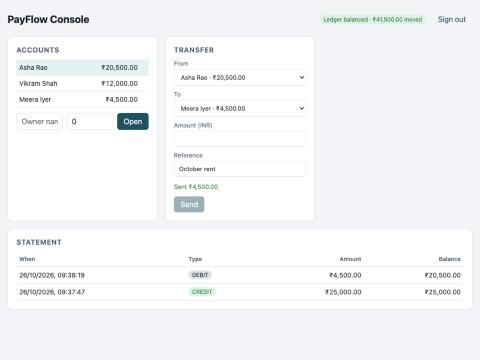

# PayFlow Ledger

An idempotent payments API on a **double-entry ledger**, with a **transactional outbox** that publishes payment events to **Kafka**, a **JWT-secured** REST API, and a **React + TypeScript** operations console.

Built with Java 21, Spring Boot 3.4, Spring Security, Spring Data JPA, PostgreSQL, Flyway, Spring Kafka, Micrometer/Prometheus, JUnit 5, Mockito, Docker and GitHub Actions.



## What it does

| Problem in real payment systems | How PayFlow handles it |
|---|---|
| A client retries after a timeout and the customer is charged twice | Every `POST /api/payments` carries an `Idempotency-Key`. The first call returns `201`; a retry returns `200` with the original payment and `Idempotent-Replay: true`. Reusing a key with a different body returns `409`. |
| Two concurrent withdrawals both see enough balance and overdraw the account | Both account rows are locked with `SELECT … FOR UPDATE` before the balance check. A test fires 20 parallel ₹10 transfers at a ₹100 account: exactly 10 succeed, the balance never goes below zero. |
| Opposite transfers A→B and B→A deadlock each other | Rows are always locked in ascending id order, so lock acquisition can't form a cycle. |
| Money appears or disappears through a bug | Every payment writes one DEBIT and one CREDIT entry. `GET /api/reports/trial-balance` checks total debits = total credits and that all balances sum to zero. |
| The DB commit succeeds but the Kafka publish fails (or the reverse) | The event row is written in the same transaction as the payment (outbox). A relay publishes pending events in order and marks them sent, so no event is lost or sent for a rolled-back payment. |

## Architecture

```
React console ──JWT──▶ Spring Boot API ──▶ PostgreSQL
                         │   account · payment · ledger_entry · outbox_event (one transaction)
                         │
                         └─ OutboxRelay (@Scheduled) ──▶ Kafka topic payments.events
```

## Run it

Without Docker (in-memory H2, Kafka relay off):

```bash
mvn spring-boot:run -Dspring-boot.run.profiles=local
cd web && npm install && npm run dev      # http://localhost:5173  (ops / ops-dev-password)
```

Full stack with PostgreSQL and Kafka:

```bash
docker compose up --build
```

Swagger UI: http://localhost:8080/swagger-ui.html · Metrics: http://localhost:8080/actuator/prometheus

## API

| Method | Path | Role |
|---|---|---|
| POST | `/api/auth/token` | public: returns a JWT for `ops` or `auditor` |
| POST | `/api/accounts` | ops: open an account with an optional opening deposit |
| GET | `/api/accounts`, `/api/accounts/{id}`, `/api/accounts/{id}/statement` | ops, auditor |
| POST | `/api/accounts/{id}/freeze` | ops |
| POST | `/api/payments` (header `Idempotency-Key`) | ops |
| GET | `/api/payments/{id}` | ops, auditor |
| GET | `/api/reports/trial-balance` | ops, auditor |

Errors use RFC 7807 problem details with a stable `code` (`INSUFFICIENT_FUNDS`, `ACCOUNT_NOT_ACTIVE`, `CURRENCY_MISMATCH`, `IDEMPOTENCY_KEY_REUSED`, `VALIDATION_FAILED`).

## Tests

```bash
mvn verify        # 14 tests + JaCoCo coverage report in target/site/jacoco
```

- `PaymentServiceTest`: balances, ledger entries, idempotent replay, key reuse conflict, rollback on insufficient funds, frozen accounts, 20-thread overdraw test, opposite-direction deadlock test.
- `PaymentApiTest`: MockMvc over the real security chain: 401 without token, 403 for auditor writes, 201 then 200 replay, 400 field errors, 422 business errors.
- `OutboxRelayKafkaTest`: embedded Kafka broker; checks the event key, payload and headers, and that the outbox row is marked published.

See [INTERVIEW_NOTES.md](INTERVIEW_NOTES.md) for the design decisions and trade-offs.
